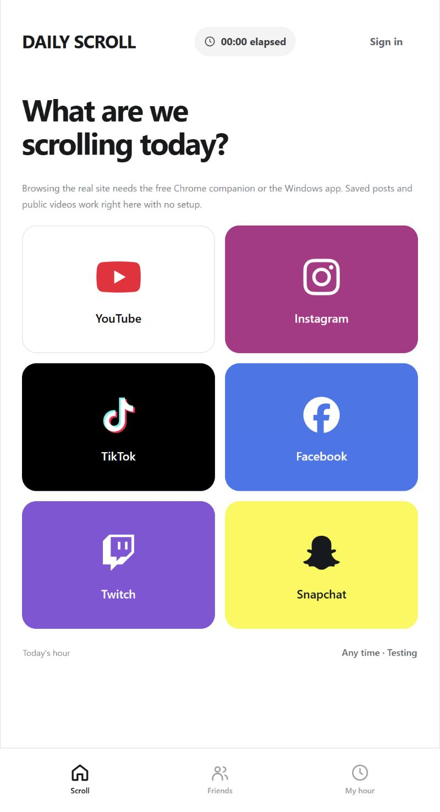
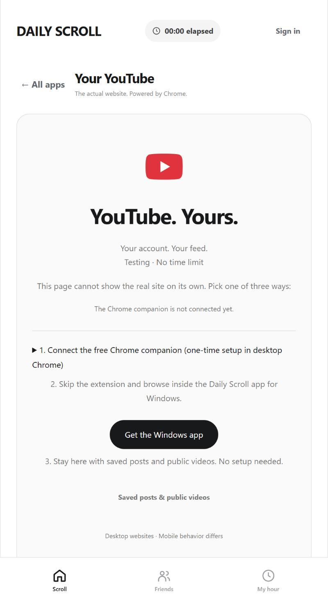

# Daily Scroll

**One hour of social media a day. Then it closes.**

Daily Scroll puts YouTube, Instagram, TikTok, Facebook, Twitch and Snapchat in one window with one shared hour a day. Pick a platform, browse its real website inside the app, signed in as yourself, and when the hour is used up the app closes the site and opens again tomorrow at the time you chose. **Pause** stops the clock. **All apps** takes you back to the picker.

It is not a blocker. Nothing stops you opening Instagram somewhere else. It is a place to do your scrolling where it is counted, so that an hour is an hour.

<p align="center"> </p>
<p align="center"><sub>The browser app in testing mode, no account signed in.</sub></p>

## Install

**Windows:** download `Daily-Scroll-Setup-<version>.exe` from the [latest release](https://github.com/jamesbobdev-gif/dailyscroll-releases/releases/latest) and run it. The installer is not code-signed yet, so Windows warns: **More info, then Run anyway**. The Windows app runs its own service, so there is nothing else to set up. The hour is on from the first launch, and installed copies update themselves.

**Android:** the `.apk` is attached to the same release when there is a phone build for that version. The phone app needs the Daily Scroll service running on a computer on the same Wi-Fi; [docs/PHONE-INSTALLATION.md](docs/PHONE-INSTALLATION.md) has the steps. The APK is signed with the project's own key and is not on Google Play.

**In a browser, from source:** Node 22 or newer, then

```
npm ci
npm run service:limited
```

and open http://localhost:8787. The browser app can show saved posts and public videos on its own. To open the real sites from it, load `chrome-companion/` as an unpacked extension in Chrome (the page explains how), or use the Windows app instead.

**iPhone:** not available yet. It needs an Apple Developer account and TestFlight setup that nobody has done.

## What's in the box

| | |
|---|---|
| **Windows app** (`desktop/`) | The whole thing in one window: a sidebar with the six platforms, back and forward, Pause and the countdown, and the real website in a browsing pane. Sign-ins stay in the app's own browser profile, separate from Chrome. |
| **Browser app** (`web/`) | The picker, your hour, saved posts, public videos and rooms, served by the service. With the Chrome companion it opens the real sites in Chrome and keeps the timer on them. |
| **Chrome companion** (`chrome-companion/`) | A small extension that lets the browser app open YouTube and the others in a managed Chrome tab, count the time, and close the tab when the hour ends. |
| **Phone app** (`App.tsx`, `NativeFeed.tsx`) | An Expo app for Android that opens each platform's mobile site with the timer on top. It talks to a service you run. |
| **The service** (`server.mjs`) | One small Node process with a JSON file for storage. It owns the hour: when it opens, how much is used, who is in which room. The Windows app bundles its own copy. |

What you get on top of the hour: a choice of when your hour starts (locked for the day once you have started scrolling), **Pause**, a "done for today" screen, saved posts you paste in, public video feeds from channels you pick, rooms where friends follow the same post, and optional YouTube and Twitch connections for your own subscriptions and follows.

## Privacy, in short

Everything stays on the computer where you use it. Your sign-ins live in the app's own browser profile and are never read or copied. The hour, your saved posts and your rooms sit in one JSON file on your machine. No account is needed; each device gets an anonymous guest profile, and a username is optional. There is no telemetry. Details, including what the service stores and what leaves your computer, are in [SECURITY.md](SECURITY.md).

## Limitations

- Some platforms refuse to sign in inside an embedded browser. Google sign-in in the YouTube view in particular may be refused. Browsing signed out works everywhere.
- Daily Scroll does not block the platforms' own apps or other browsers. The hour only counts what you do inside it.
- The browser app cannot show the real sites by itself. It needs the Chrome companion or the Windows app for that.
- The phone app is a thin shell that depends on a service you run yourself. It has had limited testing on real phones, and it is not on any app store ([docs/STORE-READINESS.md](docs/STORE-READINESS.md) says why).
- Rooms share which post is open. They do not sync playback position or play and pause.
- Public feeds and previews are not your personal recommendations. Platforms may refuse some embeds.
- The Windows installer is unsigned, so Windows shows a warning on first run.

## Working on the code

[CONTRIBUTING.md](CONTRIBUTING.md) has the layout and the ground rules. [CLAUDE.md](CLAUDE.md) is the map kept for coding assistants, and it is accurate for people too.

```
npm ci
npm run service          # testing mode: no hour, for development
npm run service:limited  # the hour on, as a user gets it
npm test                 # unit tests
npm run check            # TypeScript over the phone app
cd desktop && npm ci && npm start    # the Windows app in development
```

Testing mode counts elapsed time and never closes a site. The Windows app enforces the hour by default; `npm start -- --testing` in `desktop/` turns testing mode on there.

**Releases.** Installers live in a public repository of their own, [jamesbobdev-gif/dailyscroll-releases](https://github.com/jamesbobdev-gif/dailyscroll-releases), named in `desktop/package.json` under `build.publish`. One version number covers `package.json`, `desktop/package.json` and `app.json`. `npm run release` bumps it, builds the Windows installer on this computer and publishes it there with a SHA-256 checksum; installed copies check that repository every few hours and update themselves (`desktop/main.mjs`). Pushing a `v<version>` tag runs `.github/workflows/release.yml`, which does the same on GitHub's runners (it needs a `RELEASES_TOKEN` repository secret: a classic personal access token with the `repo` scope) and builds an unsigned Android APK for signing on the owner's computer ([docs/ANDROID-APK.md](docs/ANDROID-APK.md)). [RELEASE-NOTES.md](RELEASE-NOTES.md) describes the current release and what it leaves out.

**Hosting.** The service can run on a small HTTPS host so the phone app works away from home: [docs/HOSTING.md](docs/HOSTING.md). The Windows app never needs that.

**Other docs:** [docs/ANDROID-APK.md](docs/ANDROID-APK.md) (building and signing the phone app), [ACCOUNT-SETUP.md](ACCOUNT-SETUP.md) (the optional provider connections), [docs/DEVELOPMENT-HISTORY.md](docs/DEVELOPMENT-HISTORY.md) (earlier notes; some describe interfaces that have since changed).

Daily Scroll is independent and is not affiliated with YouTube, Instagram, TikTok, Facebook, Twitch or Snapchat.

## License

[MIT](LICENSE).
